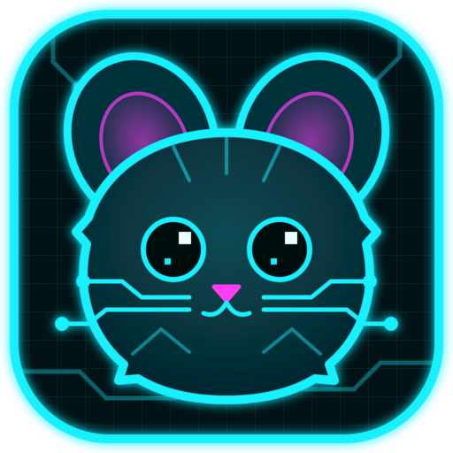
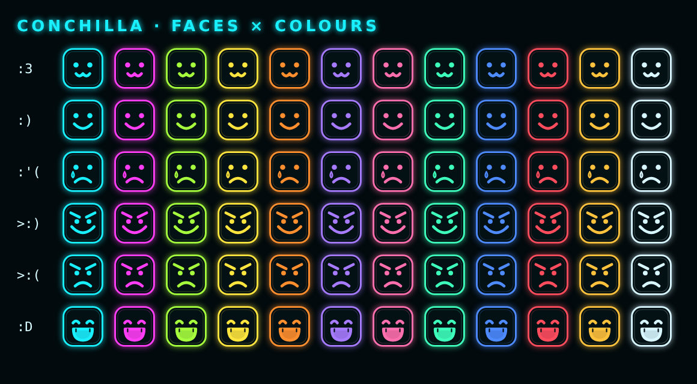

<p align="center"></p>
<h1 align="center">Conchilla</h1>
<p align="center">Easy screen sharing for your friend group · neon in-game chat · direct, no servers in between</p>

## Get it
Download **Conchilla-Setup-x.y.z.exe** from [Releases](https://github.com/Leymo0/Conchilla/releases/latest) and install it. After that, **Check for updates** on the start screen keeps it current.

## Use it
1. Pick a **name** and a **face**.
2. **Host**: start a room and send your friends the 6-letter code. Pick a screen or window, set the quality, then press **Start streaming**.
3. **Join**: type the code and press **Join**. You wait in the lobby and can chat. The stream opens by itself when the host starts sharing.

| Key | What it does |
|---|---|
| **Caps Lock** | Open the chat from any game; Enter sends, Esc cancels, and you're back in the game |
| **F7** | Show / hide stream info while watching |
| **F11** / double-click | Fullscreen |
| Scroll wheel / drag | Zoom / crop and move the picture |

All keys can be changed in ⚙ Settings.

**Host tips**
- Every viewer gets their own copy of the stream, so your **upload** needs about *bitrate × people*. The host screen shows the total.
- If a viewer's line says *your PC is maxed*, lower the resolution or fps. If it says *internet limited*, lower the bitrate.
- "Sound" shares your PC's audio. That includes Discord voice, so mute Discord on your side or use push-to-talk during movie nights.

**Overlay tips**: games must run in **borderless** or **windowed** fullscreen. Exclusive fullscreen hides every overlay.

## Faces


## Develop
```
npm install
npm start
```
Releases are built by GitHub Actions (`.github/workflows/release.yml`).
